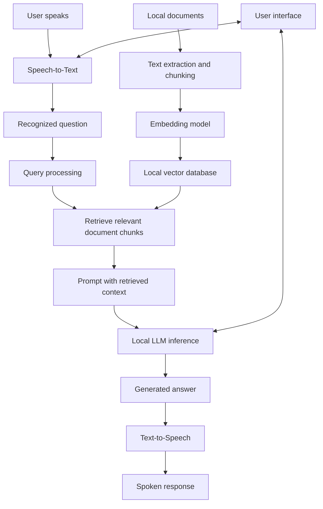
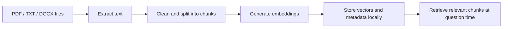

# RAGVoice 🎙️

**RAGVoice** is an offline-first, voice-enabled AI assistant that combines a locally running Large Language Model (LLM), Retrieval-Augmented Generation (RAG), Speech-to-Text (STT), and Text-to-Speech (TTS). It is designed to answer spoken questions and use your local documents as a knowledge source while keeping processing on your device after the required models and dependencies have been downloaded.

> **Project status:** Update this README as implementation details, supported file formats, and tested hardware requirements are confirmed.

## ✨ Key Features

- **Voice input:** Convert spoken questions into text using a local STT engine.
- **Local AI responses:** Generate answers with a locally hosted LLM.
- **Document-based answers (RAG):** Retrieve relevant passages from your own documents and provide them as context to the LLM.
- **Voice output:** Read generated answers aloud using a local TTS engine.
- **Local knowledge base:** Ingest documents, split text into chunks, create embeddings, and store them in a local vector index.
- **Offline-first design:** After initial setup and model downloads, the application can be configured to run without external API calls.

## 🏗️ System Architecture



## 📚 Knowledge Base Preparation

Documents are prepared and indexed locally before retrieval:



## 🔄 How It Works

1. **Ask:** The user asks a question by speaking into a microphone.
2. **Transcribe:** The local STT engine converts speech into text.
3. **Retrieve:** The application searches the local vector database for document chunks relevant to the question.
4. **Generate:** The retrieved context and user question are passed to the local LLM.
5. **Respond:** The LLM generates a text answer.
6. **Speak:** The local TTS engine converts the answer into speech and plays it to the user.

## 🧰 Suggested Technology Stack

The following are suggested components; replace them with the exact libraries and models used by the implementation.

| Component | Suggested options | Purpose |
|---|---|---|
| Programming language | Python | Application logic and pipeline integration |
| User interface | Streamlit or a desktop UI | User interaction |
| Speech-to-Text | Vosk or Whisper.cpp | Local speech recognition |
| Local LLM runtime | Ollama or llama.cpp | Run a language model on-device |
| Embeddings | Sentence Transformers | Convert text into searchable vectors |
| Vector store | FAISS or ChromaDB | Store and retrieve document embeddings |
| Text-to-Speech | Piper | Local speech synthesis |
| Document parsing | Format-specific Python libraries | Extract text from supported documents |

Frameworks such as LangChain or LlamaIndex may be added if useful, but they are optional.

## 🔒 Offline-First and Privacy

RAGVoice is designed to keep documents, retrieval, model inference, and voice processing on the local machine. The exact privacy and offline guarantees depend on the selected libraries and application configuration.

- Download models and dependencies during setup.
- Configure STT, LLM, embeddings, vector storage, and TTS to use local resources.
- Avoid external API calls in the runtime pipeline if fully offline operation is required.
- Test the application with network access disabled to verify offline behavior.

## 🚀 Getting Started

Setup instructions will be added once the source code, dependency list, and model choices are finalized.

A typical setup process will be:

1. Clone this repository.
2. Create and activate a Python virtual environment.
3. Install the project dependencies.
4. Download or configure the required local AI models.
5. Add documents to the knowledge base and build the local index.
6. Start the application and test speech input and spoken output.

## 🗂️ Planned Project Modules

A possible project structure is:

```text
RAGVoice/
├── app.py                 # Application entry point / UI
├── stt/                   # Speech-to-Text integration
├── rag/                   # Document ingestion and retrieval
├── llm/                   # Local language-model integration
├── tts/                   # Text-to-Speech integration
├── data/
│   └── documents/         # Local source documents (avoid committing private data)
├── tests/                 # Tests
├── requirements.txt       # Python dependencies
├── .gitignore
└── README.md
```

This is a suggested layout and can be adjusted to match the actual codebase.

## 🛣️ Roadmap

- [ ] Integrate local Speech-to-Text.
- [ ] Integrate local LLM inference.
- [ ] Add document ingestion and chunking.
- [ ] Build a local vector index and retrieval pipeline.
- [ ] Integrate local Text-to-Speech.
- [ ] Connect the components through a user interface.
- [ ] Add tests and document supported hardware.
- [ ] Verify end-to-end operation with the network disabled.

## 🤝 Contributing

Contributions, suggestions, and bug reports are welcome. Please describe the change clearly and test it before submitting a pull request.

## 📄 License

No license has been selected yet. Add a license file before distributing or accepting reuse of this project.
