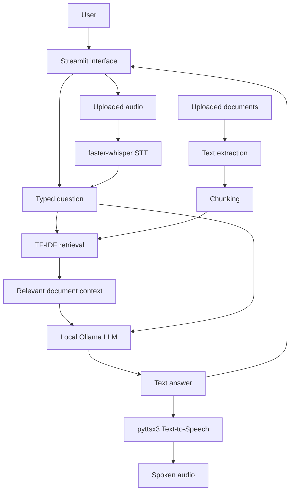

# RAGVoice 🎙️

**RAGVoice** is a local-first, voice-enabled document assistant. It combines Retrieval-Augmented Generation (RAG), a locally running LLM, Speech-to-Text (STT), and Text-to-Speech (TTS) in a Streamlit interface.

The current starter implementation supports document-grounded chat using local TF-IDF retrieval, a local Ollama model for answer generation, optional audio transcription with faster-whisper, and speech playback with pyttsx3.

## Features

- **Local LLM:** Generate answers using an Ollama model running on your machine.
- **Document Q&A:** Upload PDF, TXT, Markdown, DOCX, CSV, JSON, or Python files.
- **RAG pipeline:** Extract text, split it into overlapping chunks, retrieve relevant chunks with TF-IDF similarity, and pass the context to the LLM.
- **Speech-to-Text:** Transcribe uploaded audio recordings with faster-whisper.
- **Text-to-Speech:** Read text aloud with pyttsx3.
- **Streamlit interface:** Separate tabs for chat, knowledge-base uploads, and voice tools.
- **No hosted LLM API configured:** The app calls a local Ollama endpoint by default.

> **Note:** This is a functional starter implementation. Document chunks currently live in Streamlit session memory and are not persisted after the session resets. The first-time installation/model setup may require internet access. Verify all offline behavior on your own machine.

## Architecture



## Technology Stack

| Component | Technology |
|---|---|
| Language | Python |
| Interface | Streamlit |
| Local language model | Ollama |
| Retrieval | scikit-learn TF-IDF and cosine similarity |
| PDF parsing | pypdf |
| DOCX parsing | python-docx |
| Speech-to-Text | faster-whisper |
| Text-to-Speech | pyttsx3 |

## Requirements

- Python 3.10 or newer recommended
- [Ollama](https://ollama.com/) installed and running
- A model downloaded in Ollama, such as `llama3.2`
- Microphone/audio support is optional; voice input currently uses uploaded audio files

## Quick Start

### 1. Clone the repository

```bash
git clone https://github.com/ChetanSontakke11/Lava.git
cd Lava
```

### 2. Create a virtual environment

**Windows (PowerShell):**

```powershell
python -m venv .venv
.venv\Scripts\Activate.ps1
```

**macOS / Linux:**

```bash
python3 -m venv .venv
source .venv/bin/activate
```

### 3. Install dependencies

```bash
python -m pip install --upgrade pip
pip install -r requirements.txt
```

### 4. Set up the local LLM

Install Ollama from [ollama.com](https://ollama.com/), then run:

```bash
ollama pull llama3.2
ollama serve
```

If Ollama is already running as a background service, you may not need to run `ollama serve` manually. Keep the model name in the app sidebar matched to the model you downloaded.

### 5. Start RAGVoice

Open a terminal in the project directory, activate the virtual environment, and run:

```bash
streamlit run app.py
```

Streamlit will print a local URL, usually `http://localhost:8501`. Open it in your browser.

## How to Use

1. Open the **Knowledge Base** tab.
2. Upload one or more supported files and select **Process documents**.
3. Open **Ask RAGVoice**, enter a question, and click **Generate answer**.
4. Expand **Retrieved context** under an answer to inspect the passages used.
5. Open **Voice** to transcribe an uploaded audio recording or speak text through the machine's audio output.

The knowledge base is currently session-based; re-upload and process documents after a session reset.

## Configuration

The Ollama endpoint and default model can be configured using environment variables:

- `OLLAMA_URL` — defaults to `http://localhost:11434`
- `OLLAMA_MODEL` — defaults to `llama3.2`

You can also change the endpoint and model in the app's sidebar.

## Privacy and Offline Use

- RAGVoice does not configure a hosted LLM API; text generation uses the local Ollama endpoint.
- Uploaded documents are processed by the app and indexed in session memory.
- faster-whisper may download its speech model on first use; install/cache required models before disconnecting from the internet if you need offline operation.
- Python packages and Ollama models usually need to be downloaded during initial setup.
- Do not upload confidential documents to a remote or shared deployment unless you understand its storage and access configuration.

## Repository Structure

```text
Lava/
├── app.py             # Main Streamlit application
├── requirements.txt   # Python dependencies
├── .gitignore         # Excludes virtual environments, secrets, and local data
└── README.md          # Project overview and setup guide
```

## Troubleshooting

- **Cannot connect to Ollama:** Start Ollama and check that the sidebar URL is `http://localhost:11434` unless you configured a different endpoint.
- **Model not found:** Run `ollama pull llama3.2` or enter the name of a model already installed locally.
- **PDF/DOCX upload fails:** Confirm dependencies installed successfully with `pip install -r requirements.txt`.
- **Audio transcription fails:** faster-whisper may need its model downloaded on first use, and audio codecs/file formats can affect transcription.
- **No relevant passages:** Confirm that the uploaded files contain extractable text and that your question uses terms present in the documents.

## Roadmap

- [ ] Persist document indexes between sessions.
- [ ] Improve retrieval with local embedding models and a vector database.
- [ ] Add direct microphone capture and smoother voice conversation.
- [ ] Add source attribution with filenames and page/section metadata.
- [ ] Add automated tests and platform-specific setup instructions.
- [ ] Test the complete workflow with network access disabled.

## License

No license has been selected yet. Add a license file before distributing the project or explicitly permitting reuse.
